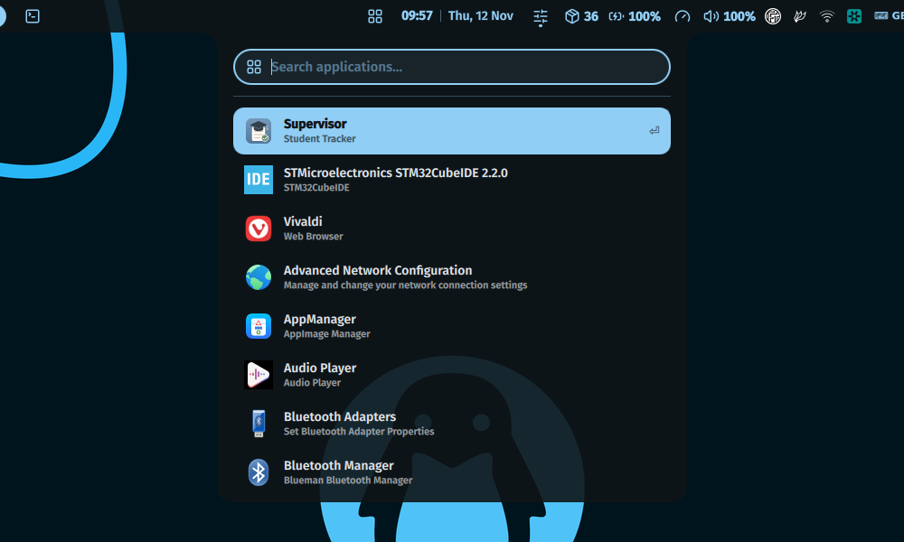

# dotfilesLaptop

Configuration files for a Hyprland desktop on Arch Linux, managed with
[GNU Stow](https://www.gnu.org/software/stow/). The configuration derives from
[ML4W OS](https://github.com/mylinuxforwork/dotfiles) 2.14.1 by Stephan Raabe.
The principal modification is a Quickshell status bar from which every panel of
the desktop is opened. A time and weather widget occupies empty workspaces.

The modifications to the ML4W files are listed under
[Changes from ML4W](#changes-from-ml4w). The configuration was developed with
the assistance of Claude (Anthropic).


## Screenshots

The modules of the status bar are defined in
`~/.config/quickshell/StatusbarApp/statusbar.json`. Two files can feed the bar
and only one of them is ever read: that one when it exists (it does), and
`~/.config/ml4w/settings/statusbar.json` only if it were deleted. The copy in
the repository *is* the live file, since `~/.config/quickshell` is the stow
link, and the IPC setters write their changes back into it. Whichever of the
two is the master is merged over the defaults built into `StatusbarWindow.qml`,
so a key left out of the file still has a value; editing the file that is *not*
the master changes nothing.


The control centre (`SUPER + CTRL + S`) contains network and Bluetooth tiles,
Do Not Disturb, Caffeine, Night Light, Gamemode, audio and brightness sliders,
an Appearance page, the weather and the active media player.


The Settings panel (`SUPER + SHIFT + S`) replaces the separate ML4W settings
application.


The wallpaper picker (`SUPER + CTRL + W`). Selecting a wallpaper runs matugen,
which regenerates the colours of the bar, GTK, kitty, rofi, btop and
Firefox.


The application launcher (`SUPER + CTRL + RETURN`, or the launcher icon in the
bar) drops from the bar like the other panels. It lists the installed
applications with their icons and filters them as you type.



## Repository structure

Each top level directory is a Stow package whose contents mirror the home
directory. For example, `hypr/.config/hypr` is linked to `~/.config/hypr`.

| Package | Target | Content |
| --- | --- | --- |
| `hypr` | `~/.config/hypr` | Hyprland configuration in Lua, keybindings in `conf/keybindings/gabriel.lua`, hypridle and hyprlock |
| `quickshell` | `~/.config/quickshell` | Status bar, desktop widget and all panels, including Settings |
| `ml4w` | `~/.config/ml4w` | ML4W scripts in use (wallpaper, clipboard, updates, toggles) and settings files |
| `matugen` | `~/.config/matugen` | Templates for the colour scheme derived from the wallpaper, including Pywalfox for Firefox |
| `rofi`, `kitty`, `fastfetch`, `btop`, `qt6ct` | `~/.config/...` | Application configuration |
| `nvim` | `~/.config/nvim` | LazyVim with LSP, DAP for C, LaTeX and snippets |
| `vim` | `~/.config/vim/.vimrc` | Minimal vim configuration for systems without Neovim |
| `tmux` | `~/.config/tmux` | tmux with `C-Space` as prefix and TPM plugins |
| `yazi` | `~/.config/yazi` | yazi file manager with additional "Open with" entries |
| `voxtype` | `~/.config/voxtype` | Push to talk dictation |
| `browserflags` | `~/.config/chromium-flags.conf`, `~/.config/edge-flags.conf` | Wayland flags for Chromium based browsers |
| `mimeapps` | `~/.config/mimeapps.list` | Default applications (Vivaldi for web links, Okular for PDF) |
| `gtk-2.0`, `gtk-3.0`, `gtk-4.0`, `xsettingsd`, `xresources` | `~/.gtkrc-2.0`, `~/.config/...`, `~/.Xresources` | GTK theme, ArcStarry cursor and kora icons |
| `fonts` | `~/.local/share/fonts` | Fira Sans, used by the bar, rofi and hyprlock |
| `cursors` | `~/.local/share/icons/ArcStarry-cursors` | Cursor theme |
| `zsh` | `~/.zshrc` | Shell configuration |
| `git` | `~/.gitconfig` | Git identity and default branch |
| `ohmyposh` | `~/Documents/mytheme_v2.toml` | Prompt theme loaded by `.zshrc` |
| `systemd` | `~/.config/systemd/user/hyprland-session.target` | Session target started by `autostart.lua` |
| `xdg-desktop-portal` | `~/.config/xdg-desktop-portal/portals.conf` | Hyprland portal as first preference |
| `wallpapers` | `~/Pictures/Wallpapers` | Wallpaper collection read by the wallpaper picker |
| `system` | `/etc/sddm.conf`, `/usr/share/sddm/themes/ml4w` | SDDM configuration and theme. Copied as root, not stowed |

## Installation

The procedure assumes a minimal Arch Linux installation with a working network
connection and a user with `sudo` rights.

### 1. AUR helper

```bash
sudo pacman -S --needed base-devel git
git clone https://aur.archlinux.org/paru-bin.git
cd paru-bin && makepkg -si
```

### 2. Packages

`packages-arch.txt` contains every package the desktop requires. AUR packages
are marked with a comment.

```bash
git clone git@github.com:g-machado-uu/dotfilesLaptop.git ~/.dotfilesLaptop
cd ~/.dotfilesLaptop
paru -S --needed $(grep -v '^#' packages-arch.txt)
```

`packages-arch-apps.txt` lists the remaining applications in use, grouped by
purpose. Sections that do not apply, such as the NVIDIA drivers, should be
removed before installation.

```bash
paru -S --needed $(grep -v '^#' packages-arch-apps.txt)
```

### 3. Browsers

Two browsers are configured. Vivaldi is the default browser (`SUPER + B` and
`mimeapps.list`). Firefox has its own keybinding (`SUPER + CTRL + F`) and
receives the matugen colour scheme through Pywalfox.

```bash
paru -S --needed vivaldi vivaldi-ffmpeg-codecs firefox python-pywalfox
pywalfox install
```

The Pywalfox extension must then be installed in Firefox from
addons.mozilla.org. The wallpaper script calls `pywalfox update` after each
wallpaper change.

### 4. Stow the packages

Existing files at the target locations must be moved before stowing, since
Stow does not overwrite them. `~/.zshrc` and `~/.gitconfig` are the usual
cases.

```bash
cd ~/.dotfilesLaptop
mkdir -p ~/.local/share/icons
stow hypr quickshell ml4w matugen rofi kitty fastfetch btop qt6ct \
     nvim vim tmux yazi voxtype browserflags mimeapps gtk-2.0 gtk-3.0 \
     gtk-4.0 xsettingsd xresources fonts cursors zsh git
stow --no-folding systemd xdg-desktop-portal ohmyposh
fc-cache -f
```

The packages `systemd`, `xdg-desktop-portal` and `ohmyposh` require
`--no-folding`. Without it Stow replaces `~/.config/systemd` or `~/Documents`
with a link into the repository.

`~/.local/share/icons` is created as a regular directory before `cursors` is
stowed. Otherwise Stow links the whole directory, and icons installed later by
applications are written into the repository.

The `wallpapers` package is optional. It is stowed with `--no-folding` so that
wallpapers added locally remain outside the repository.

```bash
stow --no-folding wallpapers
```

### 5. Login manager

The `system` package targets `/` and contains files read by SDDM before login.
These are copied rather than linked, since SDDM cannot follow links into a
home directory.

```bash
sudo cp system/etc/sddm.conf /etc/sddm.conf
sudo cp -r system/usr/share/sddm/themes/ml4w /usr/share/sddm/themes/
sudo systemctl enable sddm
```

### 6. Lock screen

The lock screen is the `field` theme of
[qylock](https://github.com/Darkkal44/qylock), a collection of Quickshell and
SDDM lock screen themes. It is not part of this repository. Its dependencies
are in `packages-arch.txt`. The repository is cloned to `~/Projects` and its
Quickshell installer is run, which installs the lock screen to
`~/.local/share/quickshell-lockscreen` and links the themes back to the clone.

```bash
git clone https://github.com/Darkkal44/qylock.git ~/Projects/qylock
cd ~/Projects/qylock
chmod +x quickshell.sh && ./quickshell.sh
```

The clone must remain in place, since the installed lock screen reads its
themes from it. Only the Quickshell part of qylock is used. SDDM keeps the ML4W
theme from step 5.

### 7. Shell and terminal multiplexer

```bash
chsh -s /usr/bin/zsh
git clone https://github.com/tmux-plugins/tpm ~/.tmux/plugins/tpm
```

The tmux plugins are installed from within tmux with `C-Space I`.

### 8. Session

Hyprland is selected at the SDDM login screen.

## Time and weather widget

The widget is displayed on empty workspaces only. When a window opens, the
widget is absorbed into the bar, which resumes displaying the clock. On an
empty workspace the clock in the bar is replaced by a calendar button. The
widget can be disabled from the Appearance page of the control centre.

The widget has three sections: time and date, current conditions, and a three
day forecast. Weather data is obtained from
[Open-Meteo](https://open-meteo.com/), which requires no API key. The data is
refreshed every 15 minutes. Until the first successful request the widget
retries every 20 seconds, since the network is often unavailable at login.

Wind is reported in METAR notation. `23009G19KT` denotes 230 degrees at 9 knots
with gusts of 19 knots. Gusts are reported only when they exceed the mean
speed by 10 knots or more. `QNH` is the pressure at mean sea level in hPa.

The text colour is chosen from the brightness of the wallpaper behind the
widget, independently of the light or dark palette selected by matugen.

The size of the widget and its return delay are set in the Statusbar tab of the
Settings panel (`weather.widgetScale` and `weather.showDelay` in
`statusbar.json`). The delay is the time a workspace must stay empty before the
widget comes back out. It prevents the widget from bouncing in and out while an
application that briefly closes its window during start-up is loading. The
widget is still absorbed into the bar without delay.

The location is set in any of three places:

* the Statusbar tab of the Settings panel
* the place name above the weather in the control centre, which becomes a text
  field when clicked
* the IPC interface of the bar

```bash
qs ipc call statusbar weatherLocation
qs ipc call statusbar setWeatherLocation "Porto, PT"
```

## Settings panel

The Settings panel opens with `SUPER + SHIFT + S`, from the control centre, or
with `qs ipc call settings toggle`. It has four tabs.

* **Appearance:** rofi border and font, wallpaper blur, and the animation,
  decoration, window, layout and workspace variants.
* **Default apps:** terminal, browser, email client, file manager, network and
  Bluetooth managers, software manager, calculator, screenshot editor, system
  monitor and AUR helper.
* **Statusbar:** weather location, and the size and return delay of the time
  and weather widget.
* **System:** keybinding, monitor, environment and window rule variants.

The entries are defined in
`quickshell/.config/quickshell/SettingsApp/settings.json`. Each entry declares
its storage method: `replace` edits one line of a file, `overwrite` rewrites the
file, and `command` runs a read command and a write command. Changing a
Hyprland variant triggers `hyprctl reload`.

## Keybindings

`SUPER` is the modifier. `SUPER + CTRL + K` displays the complete list. The
source is `hypr/.config/hypr/conf/keybindings/gabriel.lua`.

| Keys | Action |
| --- | --- |
| `SUPER + RETURN` | Terminal (kitty) |
| `SUPER + B` | Default browser (Vivaldi) |
| `SUPER + CTRL + F` | Firefox |
| `SUPER + E` | File manager |
| `SUPER + CTRL + RETURN` | Application launcher |
| `SUPER + TAB` | Workspace overview |
| `SUPER + SPACE` | Expand the bar and give it keyboard focus |
| `SUPER + CTRL + S` | Control centre |
| `SUPER + CTRL + N` | Notifications |
| `SUPER + SHIFT + S` | Settings panel |
| `SUPER + CTRL + W` | Wallpaper picker |
| `SUPER + V` | Clipboard history |
| `SUPER + CTRL + K` | Keybindings panel |
| `SUPER + ALT + M` | System monitor panel |
| `SUPER + SHIFT + M` | Toggle light and dark mode |
| `SUPER + CTRL + M` | Voxtype dictation, held while speaking |
| `SUPER + CTRL + P` | Power menu |
| `SUPER + CTRL + L` | Lock screen |
| `SUPER + Q` | Close the open bar panel, or the active window |
| `SUPER + ALT + F` | Full screen screenshot |
| `SUPER + ALT + S` | Area screenshot |
| `SUPER + ALT + A` | Text extraction from an area (tesseract) |

## Application launcher

The launcher replaces rofi's `drun` mode. It reads the same `.desktop` files
through Quickshell, so it lists the same applications. The source is
`quickshell/.config/quickshell/LauncherApp/LauncherPanel.qml`.

* **Search:** names that start with the query rank first, then words in the
  name that start with it, then the generic name and keywords, then the
  description. Letters typed in order also match, so `vsc` finds Visual Studio
  Code.
* **Most used first:** each launch is counted in
  `~/.local/state/quickshell/by-shell/<id>/launcher-usage.json`. The most used
  applications head the list when the search is empty and are ranked higher in
  the results.
* **Keys:** `Up` and `Down`, `Tab` and `Shift + Tab`, or `Ctrl + J` and
  `Ctrl + K` move the selection. `Page Up` and `Page Down` move eight entries.
  `Return` launches and `Escape` closes.
* **Terminal applications** are opened in the terminal set in the Default apps
  tab of the Settings panel.

The launcher is also opened with `qs ipc call launcher toggle`. Rofi remains
installed for the screenshot, OCR and keybinding menus, and
`hypr/.config/hypr/scripts/launcher.sh` still opens its launcher.

## Power menu and screen lock

Logout, reboot and power off are executed through `hyprshutdown`, as
recommended by the
[Hyprland wiki](https://wiki.hypr.land/Hypr-Ecosystem/hyprshutdown/). This asks
each application to close before Hyprland exits.

Locking is performed through `loginctl lock-session`, which hypridle handles.
The lock command in `hypridle.conf` and in the keybinding calls
`~/.local/share/quickshell-lockscreen/lock.sh`, the Quickshell lock screen
from qylock (see [Lock screen](#6-lock-screen)). `lock.sh` uses the `field`
theme unless another theme name is passed as its first argument, for example
`lock.sh clockwork/tape`. The previous hyprlock commands remain as comments in
both files.

On systems with SDDM and an NVIDIA GPU, a black screen after logout is resolved
by adding `--vt <n>` to the `hyprshutdown` calls in
`quickshell/.config/quickshell/PowerApp/PowerPanel.qml`, where `n` is the
virtual terminal used by SDDM.

## Keybindings panel

`SUPER + CTRL + K` drops the complete list of keybindings out of the bar, or
`qs ipc call keybinds toggle`. The source is
`quickshell/.config/quickshell/KeybindsApp/KeybindsPanel.qml`; it replaced
`scripts/keybindings.sh`, which piped `hyprctl binds` through jq and awk into a
two-line rofi list.

It reads the same thing: `hyprctl binds -j`, keeping every bind that carries a
description — which is what makes `conf/keybindings/gabriel.lua` the one place
a keybinding is written down, since the description in the bind is the text
shown in the panel. Typing filters the list, and each word of the query has to
appear somewhere in the row, so `super w` finds the wallpaper binds whichever
order they are typed in. `Up` and `Down`, `Tab` and `Shift + Tab`, or
`Ctrl + J` and `Ctrl + K` move the selection; `Page Up` and `Page Down` move
eight rows; `Escape` closes. Nothing is clickable: the list is a reference,
not a menu.

## Text extraction

`SUPER + ALT + A` drops the OCR language picker out of the bar, or
`qs ipc call ocr toggle`. Picking a language closes the panel and starts the
capture: `hyprpicker` freezes the screen, `slurp` takes the region, and
`grim`, ImageMagick and `tesseract` turn it into text on the clipboard.

The work is still `hypr/.config/hypr/scripts/text-extractor.sh`; only its rofi
language prompt moved into the panel
(`quickshell/.config/quickshell/OcrApp/OcrPanel.qml`). The script keeps the
language list, so there is only one of them:

```bash
text-extractor.sh --list-langs    # the installed languages, one per line
text-extractor.sh --lang deu      # capture with a given language
text-extractor.sh                 # capture with the only one installed, or eng
```

The panel lists what `--list-langs` reports, under the language's name where it
knows one. `osd` (tesseract's orientation and script detection data, not a
language) is filtered out. The capture starts a moment after the panel closes,
so neither hyprpicker's overlay nor slurp's region lands on top of it.

## Notifications

The shell is its own notification daemon. It implements the Desktop
Notifications specification through Quickshell's `NotificationServer`, so it
owns `org.freedesktop.Notifications` and `notify-send` and every application
reach it directly. The daemon is
`quickshell/.config/quickshell/NotificationApp/NotificationService.qml`, named
in `shell.qml` so that it comes up with the shell rather than with whichever
bar module happens to read it first.

It is deliberately quiet: **nothing is drawn over the desktop.** A notification
arriving swells the dot under the control centre icon three times and then
leaves it there, which is the whole of the alert. The notifications themselves
wait in the control centre.

There are three ways to the list, and it is the same list each time:

* the control centre's Notifications row, whose `Open` button grows it sideways
  out of the control centre's right edge (below);
* `SUPER + CTRL + N`, a **right click on the control centre icon**, or
  `qs ipc call notifications toggle`, which drop it out of the middle of the
  bar on its own, as a plain bar panel like the wallpaper and OCR panels. Right
  click works while Do Not Disturb is on, which is when going to the list
  deliberately is the only way anything reaches you;
* a click on the notification ticker in the bar (below).

Only one of the two ever stands: the standalone panel is an `openPanel` name
like any other, and the attached card is cleared whenever `openPanel` leaves
`controlcentre`.

The control centre's Notifications row shows the count and has two buttons.
`Clear all` dismisses everything; `Open` grows the list sideways out of the
control centre's right edge, and closing it sucks the card back in. The
control centre itself never moves, and neither does the bar.

The card (`shared/SideCard.qml`) grows out of the control centre rather than
appearing beside it, the way a branch grows off a trunk. It starts as a nub
level with the NOTIFICATIONS row whose `Open` button summoned it, and opens out
rightwards and downwards. It stands clear of the control centre and is joined
to it only by a short stem at its top left, so the card is square only at the
corner that stem meets and rounded on the other three. It is allowed to sit
past the bar's right edge, because it belongs to the control centre rather than
to the bar.

The stem meets the control centre the way the bar meets the top of the screen:
a concave quarter-arc tangent to the panel's edge, so the branch thickens into
the trunk instead of being butted against it. It is the same idea as
`BarShape`'s flares turned on its side — that one grows out of a horizontal
surface, this one out of a vertical edge — which is why the stem is a `Shape`
and not a rectangle, and why it is drawn exactly adjacent to the card rather
than overlapping it: these surfaces are translucent, and two of them over one
another would show as a darker band down the joint.

The joint has no square corner at either end. Its underside is one continuous
valley made of two identical quarter-arcs, each reaching half the gap across,
so they meet in the exact middle with a horizontal tangent on both sides and
the joint is symmetric. The card-side arc lands on the rule under the card's
header, which the card reports as `dividerY` — the stem's height follows from
that rather than being a number of its own, so the joint always ends on a line
that is already there. The knobs are `attachGap` (18) and `attachFlare` (half
the gap, the radius of every sweep) on the `SideCard` in
`StatusbarWindow.qml`.

The growth is two curves, not one: the width runs ahead on a decelerating
curve, so the card has reached most of the way across while it is still only a
nub tall, and the height follows on an ease-in-out that does most of its work
in the second half. It reaches out first and fills out second.

How long it takes is `notifications.spawnDuration` in `statusbar.json`
(default 320 ms), also on the Statusbar tab of the Settings panel and over
IPC:

```bash
qs ipc call statusbar notificationSpawn
qs ipc call statusbar setNotificationSpawn 550    # 0 to 2000 ms
```

(It is not called `animationDuration` because the persist helpers match a key
by name across the whole document, and `pill` already has one.)

Nothing in the card resizes a window, moves a surface or re-lays-out the list.
The content is not even drawn while the card is growing (a clip rectangle that
changes every frame with text inside it makes Qt rebuild its render batches on
each one, measured at ~4.7 ms of CPU per frame); it fades in once the card is
open, so the growth is one quad a frame. A card transition costs about 50 ms
of CPU.

### The ticker

`StatusbarApp/NotificationTickerModule.qml` is the module beside the media
slot. It is the one place the shell says *what* a notification is rather than
only that one exists: the application's icon and the notification's text, on
one line, rolling sideways when the line is longer than the slot.

|  |  |
| --- | --- |
| click | the notification list — or, for a notification that names a file, that file's folder, with the file selected |
| right click | dismiss this one; the next slides in |
| wheel | step back and forth through the waiting notifications |

Its slot is a constant width, held whether or not anything is waiting, exactly
as the media slot is: the bar's width is built from its module groups, so a
slot that came and went would widen the bar every time something arrived and
narrow it again when it was dismissed. Nothing in the bar moves for a
notification — it fades and slides in on the spot, and its text rolls inside
the room the slot already has. Under Do Not Disturb the slot stays empty:
notifications still collect and the control centre still counts them, and what
Do Not Disturb turns off is exactly this sort of asking to be read.

**The width of the bar.** `pill.expandedWidth` is a *minimum*, not a width: the
pill grows past it whenever its content needs more room, which on a full bar it
always does, so setting it smaller does nothing. The width of a full bar is the
width of its modules, and the two adjustable ones are `media.titleWidth` (90)
and `notifications.tickerWidth` (150) — between them about 2 to 3 words each.

They are also what controls the empty gap beside the centre group. The bar has
to be symmetric, because the centre group sits on the centre of the screen, so
each half reserves the *wider* of the two end groups and the narrower one
floats to its end of the bar with the difference left as empty bar. Trimming
these two slots until the left group matches the right is what closes that gap;
nothing else in the bar can. Measured on this machine: at 150/240 the left
group overran the right by 184px and that much empty bar sat to the right of
the control centre; at 90/150 the bar is 1367px instead of 1607px and the gap
is gone.

It does not roll forever. A line rolling costs about 2.4% of a core, against
0.08% for the bar at rest, and a notification that has been sitting unread for
an hour does not need to keep moving. So it rolls for 40 seconds after it
arrives — twice through a long line, at a constant 34 px/s — and then settles
back to the beginning. The pointer on it rolls it again, for as long as it is
there. The width of the slot is `notifications.tickerWidth` in `statusbar.json`
(default 240).

**The file a notification is about.** Clicking a notification that names a file
opens that file's folder with the file selected, through
`org.freedesktop.FileManager1.ShowItems` — the freedesktop interface every file
manager implements for this, and D-Bus activated, so the file manager does not
have to be running. The path is percent-encoded into a URI first, which is what
makes it safe inside the GVariant literal `gdbus` wants. Three ways of naming a
file, in order of how certain they are:

1. a `file://` URI anywhere in the text;
2. an absolute path anywhere in the text (the screenshot and wallpaper
   notifications both carry one);
3. a finished download, which usually names the file and not the folder: a text
   matching both *download* and *complete/finished/saved* has its file name
   taken to be in the download folder (`xdg-user-dir DOWNLOAD`, asked once).

Nothing here touches the disk. A file that has since been moved opens its
folder with nothing selected, which is still the right folder.

### The bar's centre, and its gaps

The hairline rule between the time and the date lands exactly on the centre of
the screen. The time and the date are each sized to their own text, so the rule
sits as far left of the clock's own centre as the date is wider than the time;
the clock reports that difference as `inkSlack` and the bar's centre group pads
its left end by it, which slides the rule back onto the centre line and leaves
the slack outside the group, as bar, where there is nothing to see.

An earlier version centred the rule by giving the time and the date a cell each
of the same width. That also put the rule on the centre line, but by leaving
the difference as blank space *in front of the time*, which pushed the launcher
icon a date's-worth further from the clock than the control centre is on the
other side. Measured ink to ink on the PC's bar: 23px from the launcher to the
time, 24px from the date to the control centre.

The left group carries its gaps as margins on each module rather than as the
layout's spacing, so a module can ask for less. The round icon buttons want the
full gap between their hover circles; the media and notification slots are wide
pills whose ink starts 10px inside their own edge, so the full gap on top of
that read as a hole. They set `gapBefore: 0` and sit against their neighbour's
half of the gap alone.

### The list

The list inside is `NotificationApp/NotificationPanel.qml`:

* Newest first, each card with the application icon and name, how long ago it
  arrived, the summary, the body and whatever action buttons the notification
  carries. An urgent notification is outlined.
* A `×` appears on a card under the pointer and dismisses that one.
* `qs ipc call notificationlist toggle` opens the control centre and the card
  together from a script.

A notification is kept until it is dismissed. The `expireTimeout` an
application asks for is ignored, because there is no popup for it to time out
of. Notifications marked *transient* — the volume and brightness overlays — are
dropped instead of collected, since they are meant to be seen on screen and
there is no screen for them here.

**Do Not Disturb** is the tile in the control centre. Notifications still
collect while it is on; what stops is the dot pulsing for them. Urgent
notifications pulse regardless, which is what marking one urgent is for. The
state is kept in `~/.config/ml4w/settings/notifications.json` so it survives a
restart, and is read back on change so every bar agrees.

This replaced swaync, which was the notification daemon until then. Only one
notification server can own the D-Bus name, so swaync must not be running: it
is no longer started in `conf/autostart.lua`, and `swaync` is no longer in
`packages-arch.txt`. After the change, `pkill swaync` hands the name over
without a logout — the shell registers it as soon as it is free.

## Changes from ML4W

**Removed**

* waybar and its themes
* the ML4W dock (nwg-dock-hyprland)
* the walker, waypaper and wlogout configurations
* the welcome application and the ML4W settings application
* the theme switcher (`ml4w/themes`), which only affected waybar, the dock and
  walker
* the ML4W installation and update scripts
* approximately 20 scripts without callers
* `ml4w-wallpaper-effects` and its entry in the wallpaper picker
* matugen outputs for the removed applications

**Replaced**

* swaync, by the shell's own notification daemon and the notification card
  that grows out of the control centre
* the rofi keybindings list (`scripts/keybindings.sh`), by the keybindings
  panel
* the rofi OCR language prompt, by the OCR panel; `text-extractor.sh` keeps
  the capture and the language list
* the settings application, by the Settings panel
* `ml4w-power`, by `hyprshutdown`
* the launcher script, by the Quickshell launcher
* the status bar toggle and reload scripts, by Quickshell IPC calls

**Modified**

* **Sidebar:** merged into the control centre. Duplicated controls were
  removed. Gamemode became a tile, and the theme tools moved to the Appearance
  page.
* **`SUPER + Q`:** closes an open bar panel before closing windows.
* **Wallpaper script and GTK theme listener:** no longer restart waybar or the
  dock. The wallpaper script also updates Pywalfox.
* **Autostart log:** written to `~/.cache/ml4w-autostart.log`.
* **Retained:** the paths under `~/.config/ml4w` and the `ml4w-wallpaper`
  script, so that existing callers remain valid.

**Added**

* the Quickshell bar and its panels
* the keyboard layout indicator
* the time and weather widget
* the application launcher
* the keybindings and the fluidDrop animation
* the window rules, and the hypridle, kitty, fastfetch, nvim, vim, tmux and
  voxtype configurations

`ML4W_BASELINE` records the upstream version. `./upstream-diff.sh` lists the
upstream changes since that version in the directories this repository
replaces. `./upstream-diff.sh --mine` lists the local changes relative to the
baseline.

## Known limitations

* **Lock screen:** depends on qylock, which is installed separately. Without
  it, `SUPER + CTRL + L` and the idle timeout do not lock the session.
* **Filen:** `autostart.lua` starts `~/Applications/Filen`, an AppImage that is
  installed manually. AppImages require `fuse2`, which is in
  `packages-arch.txt`.
* **`SUPER + CTRL + C`** is bound twice, to the calculator and to the calendar.

## Credits and licences

* **ML4W OS** by Stephan Raabe, GPL 3.0. The basis of this configuration and
  the source of the wallpapers.
* **Files derived from ML4W:** GPL 3.0 (`LICENSE`).
* **Fira Sans:** SIL Open Font License
  (`fonts/.local/share/fonts/Fira_Sans/OFL.txt`).
* **ArcStarry cursors:** GPL 3.0.
* **`quickshell/overview`:** a separate project with its own README. The main
  shell loads it on demand instead of running it as a second Quickshell
  process.
* **qylock** by Darkkal44, the lock screen. Installed separately, not
  redistributed here.
