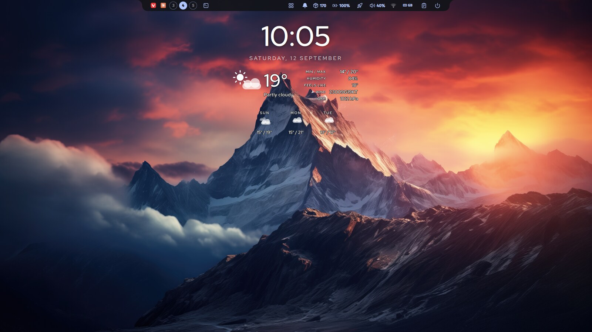
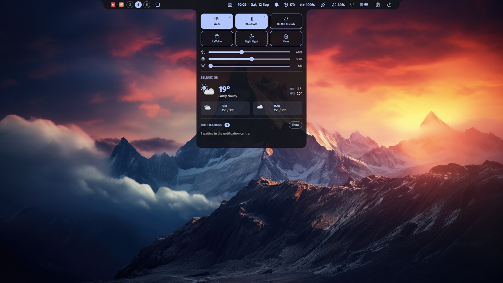
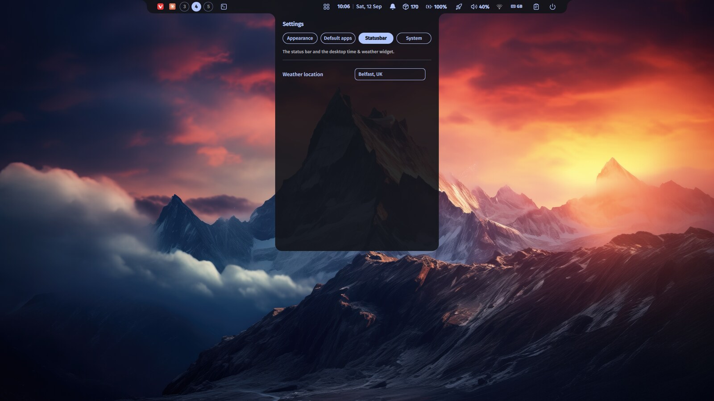
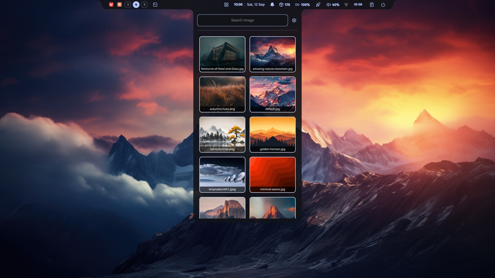

# dotfilesLaptop

Configuration files for a Hyprland desktop on Arch Linux, managed with
[GNU Stow](https://www.gnu.org/software/stow/). The configuration derives from
[ML4W OS](https://github.com/mylinuxforwork/dotfiles) 2.14.1 by Stephan Raabe.
The principal modification is a Quickshell status bar from which every panel of
the desktop is opened. A time and weather widget occupies empty workspaces.

The modifications to the ML4W files are listed under
[Changes from ML4W](#changes-from-ml4w). The configuration was developed with
the assistance of Claude (Anthropic).



## Screenshots

The modules of the status bar are defined in
`~/.config/ml4w/settings/statusbar.json`, following the ML4W convention.


The control centre (`SUPER + CTRL + S`) contains network and Bluetooth tiles,
Do Not Disturb, Caffeine, Night Light, Gamemode, audio and brightness sliders,
an Appearance page, the weather and the active media player.



The Settings panel (`SUPER + SHIFT + S`) replaces the separate ML4W settings
application.



The wallpaper picker (`SUPER + CTRL + W`). Selecting a wallpaper runs matugen,
which regenerates the colours of the bar, GTK, kitty, rofi, btop, swaync and
Firefox.



## Repository structure

Each top level directory is a Stow package whose contents mirror the home
directory. For example, `hypr/.config/hypr` is linked to `~/.config/hypr`.

| Package | Target | Content |
| --- | --- | --- |
| `hypr` | `~/.config/hypr` | Hyprland configuration in Lua, keybindings in `conf/keybindings/gabriel.lua`, hypridle and hyprlock |
| `quickshell` | `~/.config/quickshell` | Status bar, desktop widget and all panels, including Settings |
| `ml4w` | `~/.config/ml4w` | ML4W scripts in use (wallpaper, clipboard, updates, toggles) and settings files |
| `matugen` | `~/.config/matugen` | Templates for the colour scheme derived from the wallpaper, including Pywalfox for Firefox |
| `rofi`, `swaync`, `kitty`, `fastfetch`, `btop`, `qt6ct` | `~/.config/...` | Application configuration |
| `nvim` | `~/.config/nvim` | LazyVim with LSP, DAP for C, LaTeX and snippets |
| `vim` | `~/.config/vim/.vimrc` | Minimal vim configuration for systems without Neovim |
| `tmux` | `~/.config/tmux` | tmux with `C-Space` as prefix and TPM plugins |
| `yazi` | `~/.config/yazi` | yazi file manager with additional "Open with" entries |
| `voxtype` | `~/.config/voxtype` | Push to talk dictation |
| `browserflags` | `~/.config/chromium-flags.conf`, `~/.config/edge-flags.conf` | Wayland flags for Chromium based browsers |
| `mimeapps` | `~/.config/mimeapps.list` | Default applications (Vivaldi for web links, Okular for PDF) |
| `gtk-2.0`, `gtk-3.0`, `gtk-4.0`, `xsettingsd`, `xresources` | `~/.gtkrc-2.0`, `~/.config/...`, `~/.Xresources` | GTK theme, ArcStarry cursor and kora icons |
| `fonts` | `~/.local/share/fonts` | Fira Sans, used by the bar, rofi and hyprlock |
| `cursors` | `~/.local/share/icons/ArcStarry-cursors` | Cursor theme |
| `zsh` | `~/.zshrc` | Shell configuration |
| `git` | `~/.gitconfig` | Git identity and default branch |
| `ohmyposh` | `~/Documents/mytheme_v2.toml` | Prompt theme loaded by `.zshrc` |
| `systemd` | `~/.config/systemd/user/hyprland-session.target` | Session target started by `autostart.lua` |
| `xdg-desktop-portal` | `~/.config/xdg-desktop-portal/portals.conf` | Hyprland portal as first preference |
| `wallpapers` | `~/Pictures/Wallpapers` | Wallpaper collection read by the wallpaper picker |
| `system` | `/etc/sddm.conf`, `/usr/share/sddm/themes/ml4w` | SDDM configuration and theme. Copied as root, not stowed |

## Installation

The procedure assumes a minimal Arch Linux installation with a working network
connection and a user with `sudo` rights.

### 1. AUR helper

```bash
sudo pacman -S --needed base-devel git
git clone https://aur.archlinux.org/paru-bin.git
cd paru-bin && makepkg -si
```

### 2. Packages

`packages-arch.txt` contains every package the desktop requires. AUR packages
are marked with a comment.

```bash
git clone git@github.com:g-machado-uu/dotfilesLaptop.git ~/.dotfilesLaptop
cd ~/.dotfilesLaptop
paru -S --needed $(grep -v '^#' packages-arch.txt)
```

`packages-arch-apps.txt` lists the remaining applications in use, grouped by
purpose. Sections that do not apply, such as the NVIDIA drivers, should be
removed before installation.

```bash
paru -S --needed $(grep -v '^#' packages-arch-apps.txt)
```

### 3. Browsers

Two browsers are configured. Vivaldi is the default browser (`SUPER + B` and
`mimeapps.list`). Firefox has its own keybinding (`SUPER + CTRL + F`) and
receives the matugen colour scheme through Pywalfox.

```bash
paru -S --needed vivaldi vivaldi-ffmpeg-codecs firefox python-pywalfox
pywalfox install
```

The Pywalfox extension must then be installed in Firefox from
addons.mozilla.org. The wallpaper script calls `pywalfox update` after each
wallpaper change.

### 4. Stow the packages

Existing files at the target locations must be moved before stowing, since
Stow does not overwrite them. `~/.zshrc` and `~/.gitconfig` are the usual
cases.

```bash
cd ~/.dotfilesLaptop
mkdir -p ~/.local/share/icons
stow hypr quickshell ml4w matugen rofi swaync kitty fastfetch btop qt6ct \
     nvim vim tmux yazi voxtype browserflags mimeapps gtk-2.0 gtk-3.0 \
     gtk-4.0 xsettingsd xresources fonts cursors zsh git
stow --no-folding systemd xdg-desktop-portal ohmyposh
fc-cache -f
```

The packages `systemd`, `xdg-desktop-portal` and `ohmyposh` require
`--no-folding`. Without it Stow replaces `~/.config/systemd` or `~/Documents`
with a link into the repository.

`~/.local/share/icons` is created as a regular directory before `cursors` is
stowed. Otherwise Stow links the whole directory, and icons installed later by
applications are written into the repository.

The `wallpapers` package is optional. It is stowed with `--no-folding` so that
wallpapers added locally remain outside the repository.

```bash
stow --no-folding wallpapers
```

### 5. Login manager

The `system` package targets `/` and contains files read by SDDM before login.
These are copied rather than linked, since SDDM cannot follow links into a
home directory.

```bash
sudo cp system/etc/sddm.conf /etc/sddm.conf
sudo cp -r system/usr/share/sddm/themes/ml4w /usr/share/sddm/themes/
sudo systemctl enable sddm
```

### 6. Lock screen

The lock screen is the `field` theme of
[qylock](https://github.com/Darkkal44/qylock), a collection of Quickshell and
SDDM lock screen themes. It is not part of this repository. Its dependencies
are in `packages-arch.txt`. The repository is cloned to `~/Projects` and its
Quickshell installer is run, which installs the lock screen to
`~/.local/share/quickshell-lockscreen` and links the themes back to the clone.

```bash
git clone https://github.com/Darkkal44/qylock.git ~/Projects/qylock
cd ~/Projects/qylock
chmod +x quickshell.sh && ./quickshell.sh
```

The clone must remain in place, since the installed lock screen reads its
themes from it. Only the Quickshell part of qylock is used. SDDM keeps the ML4W
theme from step 5.

### 7. Shell and terminal multiplexer

```bash
chsh -s /usr/bin/zsh
git clone https://github.com/tmux-plugins/tpm ~/.tmux/plugins/tpm
```

The tmux plugins are installed from within tmux with `C-Space I`.

### 8. Session

Hyprland is selected at the SDDM login screen.

## Time and weather widget

The widget is displayed on empty workspaces only. When a window opens, the
widget is absorbed into the bar, which resumes displaying the clock. On an
empty workspace the clock in the bar is replaced by a calendar button. The
widget can be disabled from the Appearance page of the control centre.

The widget has three sections: time and date, current conditions, and a three
day forecast. Weather data is obtained from
[Open-Meteo](https://open-meteo.com/), which requires no API key. The data is
refreshed every 15 minutes. Until the first successful request the widget
retries every 20 seconds, since the network is often unavailable at login.

Wind is reported in METAR notation. `23009G19KT` denotes 230 degrees at 9 knots
with gusts of 19 knots. Gusts are reported only when they exceed the mean
speed by 10 knots or more. `QNH` is the pressure at mean sea level in hPa.

The text colour is chosen from the brightness of the wallpaper behind the
widget, independently of the light or dark palette selected by matugen.

The location is set in any of three places:

* the Statusbar tab of the Settings panel
* the place name above the weather in the control centre, which becomes a text
  field when clicked
* the IPC interface of the bar

```bash
qs ipc call statusbar weatherLocation
qs ipc call statusbar setWeatherLocation "Porto, PT"
```

## Settings panel

The Settings panel opens with `SUPER + SHIFT + S`, from the control centre, or
with `qs ipc call settings toggle`. It has four tabs.

* **Appearance:** rofi border and font, wallpaper blur, and the animation,
  decoration, window, layout and workspace variants.
* **Default apps:** terminal, browser, email client, file manager, network and
  Bluetooth managers, software manager, calculator, screenshot editor, system
  monitor and AUR helper.
* **Statusbar:** weather location.
* **System:** keybinding, monitor, environment and window rule variants.

The entries are defined in
`quickshell/.config/quickshell/SettingsApp/settings.json`. Each entry declares
its storage method: `replace` edits one line of a file, `overwrite` rewrites the
file, and `command` runs a read command and a write command. Changing a
Hyprland variant triggers `hyprctl reload`.

## Keybindings

`SUPER` is the modifier. `SUPER + CTRL + K` displays the complete list. The
source is `hypr/.config/hypr/conf/keybindings/gabriel.lua`.

| Keys | Action |
| --- | --- |
| `SUPER + RETURN` | Terminal (kitty) |
| `SUPER + B` | Default browser (Vivaldi) |
| `SUPER + CTRL + F` | Firefox |
| `SUPER + E` | File manager |
| `SUPER + CTRL + RETURN` | Application launcher |
| `SUPER + SPACE` | Expand the bar and give it keyboard focus |
| `SUPER + CTRL + S` | Control centre |
| `SUPER + SHIFT + S` | Settings panel |
| `SUPER + CTRL + W` | Wallpaper picker |
| `SUPER + V` | Clipboard history |
| `SUPER + ALT + M` | Floating system monitor |
| `SUPER + SHIFT + M` | Toggle light and dark mode |
| `SUPER + CTRL + M` | Voxtype dictation, held while speaking |
| `SUPER + CTRL + P` | Power menu |
| `SUPER + CTRL + L` | Lock screen |
| `SUPER + Q` | Close the open bar panel, or the active window |
| `SUPER + ALT + F` | Full screen screenshot |
| `SUPER + ALT + S` | Area screenshot |
| `SUPER + ALT + A` | Text extraction from an area (tesseract) |

## Power menu and screen lock

Logout, reboot and power off are executed through `hyprshutdown`, as
recommended by the
[Hyprland wiki](https://wiki.hypr.land/Hypr-Ecosystem/hyprshutdown/). This asks
each application to close before Hyprland exits.

Locking is performed through `loginctl lock-session`, which hypridle handles.
The lock command in `hypridle.conf` and in the keybinding calls
`~/.local/share/quickshell-lockscreen/lock.sh`, the Quickshell lock screen
from qylock (see [Lock screen](#6-lock-screen)). `lock.sh` uses the `field`
theme unless another theme name is passed as its first argument, for example
`lock.sh clockwork/tape`. The previous hyprlock commands remain as comments in
both files.

On systems with SDDM and an NVIDIA GPU, a black screen after logout is resolved
by adding `--vt <n>` to the `hyprshutdown` calls in
`quickshell/.config/quickshell/PowerApp/PowerPanel.qml`, where `n` is the
virtual terminal used by SDDM.

## Notifications

Notifications are handled by swaync. The control centre displays the number of
pending notifications and opens the swaync window.

## Changes from ML4W

**Removed**

* waybar and its themes
* the ML4W dock (nwg-dock-hyprland)
* the walker, waypaper and wlogout configurations
* the welcome application and the ML4W settings application
* the theme switcher (`ml4w/themes`), which only affected waybar, the dock and
  walker
* the ML4W installation and update scripts
* approximately 20 scripts without callers
* matugen outputs for the removed applications

**Replaced**

* the settings application, by the Settings panel
* `ml4w-power`, by `hyprshutdown`
* the launcher script, by rofi
* the status bar toggle and reload scripts, by Quickshell IPC calls

**Modified**

* **Sidebar:** merged into the control centre. Duplicated controls were
  removed. Gamemode became a tile, and the theme tools moved to the Appearance
  page.
* **`SUPER + Q`:** closes an open bar panel before closing windows.
* **Wallpaper script and GTK theme listener:** no longer restart waybar or the
  dock. The wallpaper script also updates Pywalfox.
* **Autostart log:** written to `~/.cache/ml4w-autostart.log`.
* **Retained:** the paths under `~/.config/ml4w` and the `ml4w-wallpaper`
  script, so that existing callers remain valid.

**Added**

* the Quickshell bar and its panels
* the keyboard layout indicator
* the time and weather widget
* the keybindings and the fluidDrop animation
* the window rules, and the hypridle, kitty, fastfetch, nvim, vim, tmux and
  voxtype configurations

`ML4W_BASELINE` records the upstream version. `./upstream-diff.sh` lists the
upstream changes since that version in the directories this repository
replaces. `./upstream-diff.sh --mine` lists the local changes relative to the
baseline.

## Known limitations

* **Lock screen:** depends on qylock, which is installed separately. Without
  it, `SUPER + CTRL + L` and the idle timeout do not lock the session.
* **Filen:** `autostart.lua` starts `~/Applications/Filen`, an AppImage that is
  installed manually. AppImages require `fuse2`, which is in
  `packages-arch.txt`.
* **`SUPER + CTRL + C`** is bound twice, to the calculator and to the calendar.

## Credits and licences

* **ML4W OS** by Stephan Raabe, GPL 3.0. The basis of this configuration and
  the source of the wallpapers.
* **Files derived from ML4W:** GPL 3.0 (`LICENSE`).
* **Fira Sans:** SIL Open Font License
  (`fonts/.local/share/fonts/Fira_Sans/OFL.txt`).
* **ArcStarry cursors:** GPL 3.0.
* **`quickshell/overview`:** a separate project with its own README.
* **qylock** by Darkkal44, the lock screen. Installed separately, not
  redistributed here.
